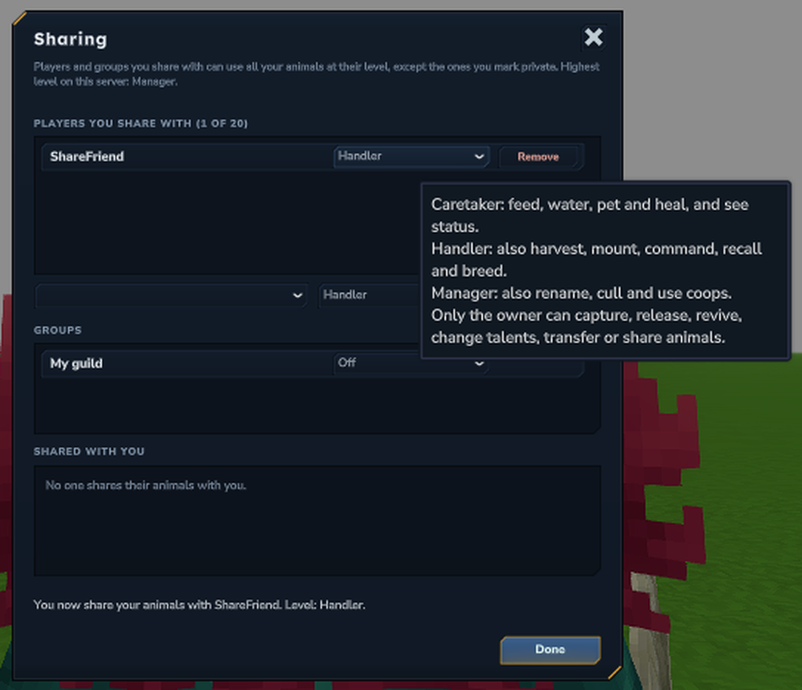
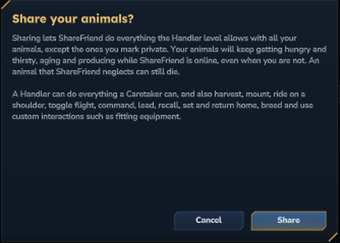
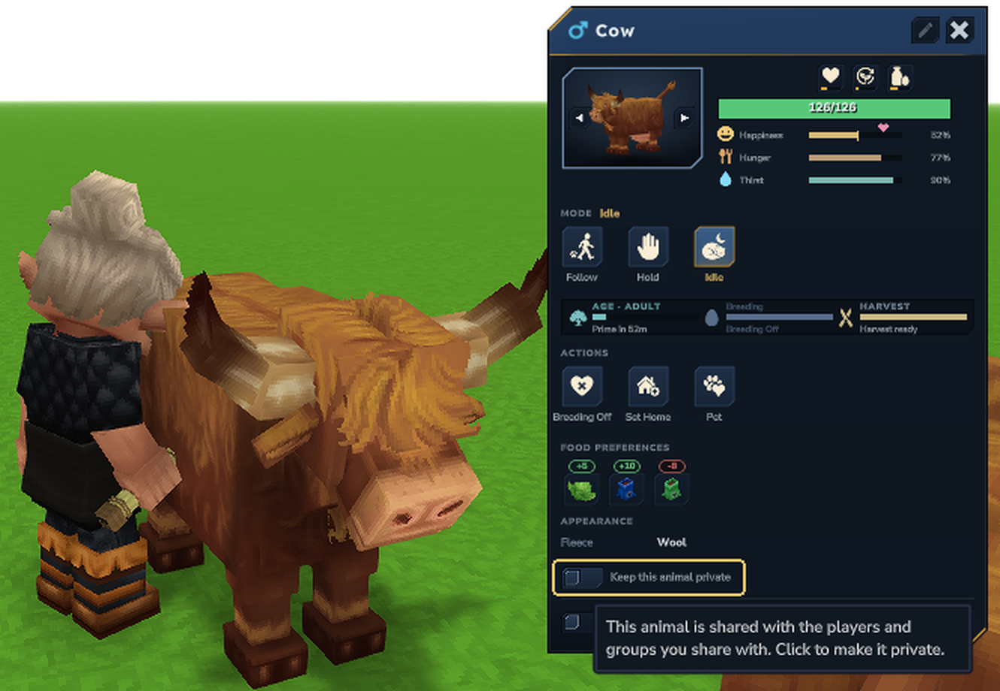
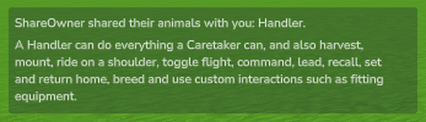
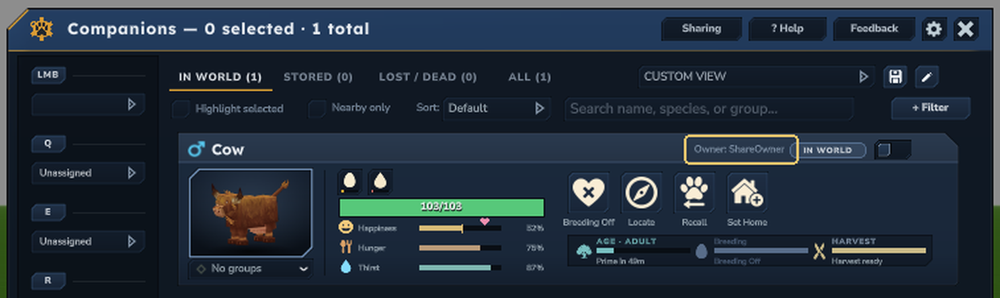

# Sharing Your Animals

Parent: [Systems](/mod/alecs-tamework/systems) | [Player Guides](/mod/alecs-tamework/player-guides)

You can let friends feed, ride or manage your tamed animals while you stay their only owner. Sharing never moves an
animal to another player, and your population limits still count your animals the same way.

## What sharing covers

- A share covers all of your animals at once. You can keep single animals to yourself (see
  [Keep an animal private](#keep-an-animal-private)).
- Bonded companions are never shared.
- You choose a level for each player. A higher level includes everything the lower ones allow.
- The server can turn sharing off or lower the highest level an owner may give (see
  [Server settings](#server-settings)).

## Levels

| Level | What the player can do |
| --- | --- |
| Caretaker | Feed, water, pet and heal your animals, and see their status. Tamework's attack and defend behaviors never target them, and they cannot hurt your animals. |
| Handler | Everything a Caretaker can do, plus: harvest (milk, wool and so on), mount, shoulder ride, toggle flight, command the animal with their own command item, lead it, recall it, set and return its home, breed it, and use custom interactions such as fitting equipment. |
| Manager | Everything a Handler can do, plus: rename, cull, and put the animal in a coop or take it out. |

You don't need to remember this table: hover any level picker on the Sharing page to see it.

A Manager counts as the owner for the server's damage settings. If the server lets owners hurt their own animals,
a Manager can too, and a Manager's killing blow counts as a cull where yours would. Caretakers and Handlers can
never hurt a shared animal.

## Open the Sharing page

Open your companions window with your command item and press **Sharing** in the header, next to Help.

The page has three lists:

- **Players you share with**: each player's level and a **Remove** button, plus a row to add a player.
- **Groups**: the groups other mods offer, such as a guild, each with its own level or **Off**.
- **Shared with you**: the players who share their animals with you and your level on each.

The top of the page says the highest level this server allows. A line near the bottom says what happened after each
change, and **Done** takes you back to the companions window.

## Share with a player

The player must be online when you share with them or change their level.

1. In the add row, pick the player and a level.
2. Press **Share**.
3. Read the confirmation. It says what the level allows and what sharing means for hunger (see
   [Hunger, aging and production](#hunger-aging-and-production)). Press **Share** again to confirm.

The player gets a message that you shared your animals with them, and what their level lets them do. You can share
with up to 20 players by name.

To change a player's level, pick a new one on their row. A change does not ask you to confirm. To stop sharing with
them, press **Remove**. Remove works while the player is offline.

**With commands:** `/tw share add <player> <caretaker|handler|manager>` shows the same confirmation; run it again
with `confirm` at the end, for example `/tw share add Steve handler confirm`. Run it again with another level to
change it, and `/tw share remove <player>` to stop.

## Share with a group

Some mods offer groups, such as your guild. A group gives nothing until you turn it on, and it then covers
everyone in the group, including players who join it later.

1. On the Sharing page, pick a level in the group's picker.
2. Read the confirmation and press **Share**.
3. Pick **Off** to turn the group off again.

If a player is both named and in a group you share with, they get the higher of the two levels. If no mod on the
server offers a group, the Groups list says so.

**With commands:** `/tw share list` shows the groups you can turn on and their ids. Then run
`/tw share group <groupId> <caretaker|handler|manager>`, read the reply, and run it again with `confirm` at the end.
`/tw share group <groupId> off` turns it off.

## Keep an animal private

Open **Companion Inspect** on one of your animals (press **F** on it) and turn on **Keep this animal private**. No
player or group you share with can use it then. Turn the switch off to share it again.

The switch appears on your own animals once you share with someone, or on an animal you already marked private.
Only the owner can change it. Bonded companions are always private.

**With commands:** look at the animal and run `/tw share private on`, or `/tw share private off` to share it
again.

## Animals shared with you

When someone shares with you, you get a message with your level and what it lets you do.

Animals shared with you at Handler or Manager appear in your own companions window, next to your own animals, with
**Owner:** and their owner's name on the card. You can select them for your command item, command, recall and locate
them, and use the buttons your level allows. A Handler can command, ride, breed and set homes, and a Manager can also
cull. Buttons that stay with the owner, such as Release, are not shown.

Caretakers do not see the owner's animals in the window. Animals in a command-family roster or stored in an item are
left out, because only their owner's item can act on them. The window updates by itself when someone shares with
you, changes your level or stops sharing.

Press **F** on a shared animal to open **Companion Inspect**, as you would on your own. It shows the owner's name
under the portrait and offers only the buttons your level allows. Talents stay with the owner.

## Leave someone's share

If another player shares their animals with you by name and you no longer want that, press **Leave** on their row in
**Shared with you**. You cannot leave a share you have through a group, because group membership belongs to the
group. If you are both named and in a group, leaving removes only the named share.

**With commands:** `/tw share leave <player>`.

## Hunger, aging and production

**When you share, your animals stop waiting for you alone.** On many servers, an animal's hunger, aging and harvest
timers pause for a grace time after its owner logs off. A shared animal instead acts as if you were online while you
or anyone you share with is online:

- it gets hungry and thirsty;
- it keeps aging; and
- its harvest and breeding timers keep running.

If nobody feeds it, it can starve, even while you are offline. Share only with players you trust to look after your
animals, and mark an animal private if it should wait for you.

Private animals and bonded companions follow you alone, as before. When neither you nor anyone you share with is
online, the server's usual owner-offline rules apply, including the grace time. A server set to ignore owner presence
is not affected by any of this. See
[Happiness, Needs, Breeding, and Traits](/mod/alecs-tamework/happiness-needs-breeding-and-traits).

## What stays with the owner

Only the owner can:

- capture the animal into an item or release it;
- pay for a revive;
- choose talents;
- transfer the animal; and
- share it, or mark it private.

The owner also stays the owner for population limits and anything else that counts whose animal it is.

## Server settings

Admins find two settings in the Ownership section of `/tw settings`:

- **Sharing Enabled** (on by default). When it is off, only owners have access. Saved shares are kept and apply
  again when sharing is turned back on. The Sharing page says so and has no add row, but owners can still remove
  players and turn groups off.
- **Highest Sharing Level** (Manager by default). Owners cannot share above it, and a share saved at a higher level
  counts as this level.

See [Tamework Settings UI and Persistence](/mod/alecs-tamework/tamework-settings-ui-and-persistence) for details.

## Command reference

Every player can use these; none needs an admin permission.

| Command | What it does |
| --- | --- |
| `/tw share add <player> <level> [confirm]` | Share with an online player, or change their level. A new share needs `confirm`. |
| `/tw share remove <player>` | Stop sharing with a player. |
| `/tw share group <groupId> <level\|off> [confirm]` | Turn a group on at a level, change it, or turn it off. Turning it on needs `confirm`. |
| `/tw share list` | Show who you share with, your groups, how many animals are private, and who shares with you. |
| `/tw share leave <player>` | Leave a share another player gave you by name. |
| `/tw share private <on\|off>` | Keep the animal you are looking at private, or share it again. |

## Related Pages
- [Ownership, Taming, and Interaction Basics](/mod/alecs-tamework/ownership-taming-and-interaction-basics)
- [Happiness, Needs, Breeding, and Traits](/mod/alecs-tamework/happiness-needs-breeding-and-traits)
- [Coops, Feed Troughs, and Shared Systems](/mod/alecs-tamework/coops-feed-troughs-and-shared-systems)
